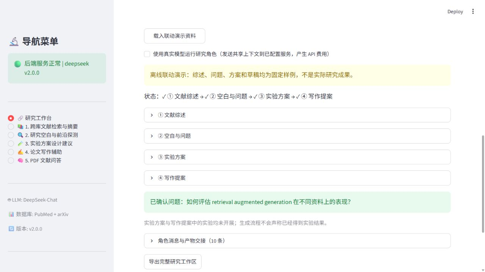
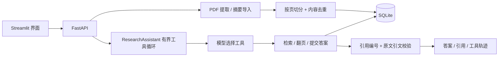

# 文献研究助手 · Evidence-first Literature Agent



从公司培训项目整理、扩展的个人作品集。原有 **PubMed / arXiv 检索 → 综述生成** 工作流保留；2026 年 10 月新增 **PDF 入库、RAG 文献问答、原生 Function Calling、逐条引用校验和执行轨迹**。

## 先看效果：不需要 API Key

Python 3.10+，建议独立虚拟环境：

```bash
python -m venv .venv
# Windows: .venv\Scripts\activate
# macOS/Linux: source .venv/bin/activate
python -m pip install -r requirements.txt
python scripts/offline_demo.py
python scripts/coordination_demo.py
python -m unittest discover -s tests -v
python run.py
```

界面：<http://localhost:8501>；API：<http://localhost:8000/docs>。进入「研究工作台」创建主题，使用其文献库；或进入「5. PDF 文献问答」独立建库，载入示例或导入论文，再运行离线演示。**离线模式使用确定性测试替身，只演示流程，不代表真实模型推理效果。**

## 功能和边界

| 能力 | 实际实现 |
| --- | --- |
| 双源检索 | PubMed 与 arXiv 并发请求；单源失败保留另一源结果，返回来源状态 |
| 文献去重 | 完整标题归一化、DOI 归一化；不再截取标题前 50 字符 |
| PDF / 摘要入库 | SQLite 持久化；内容哈希去重；按页切分，保留文献、页码与字符偏移 |
| RAG 检索 | BM25；英文词和中文二元词切分。当前**没有语义向量检索或 reranker** |
| 工具调用 | OpenAI-compatible 原生 tools：`search_library`、`get_page`、`submit_answer`；模型选择下一步动作 |
| 引用门禁 | 每条结论必须引用已检索片段；引文必须能在片段中逐字匹配（忽略空白差异） |
| 失败控制 | 工具白名单、参数验证、最多 5 轮 / 8 次工具调用；不足时返回无答案状态 |
| 可观察性 | 返回工具名称、输入、结果片段编号、拒绝原因；导出问答 JSON |
| 研究联动 | ReviewAgent → GapAgent → ExperimentAgent → WritingAgent；共享文献库、类型化产物和交接事件 |
| 依赖管理 | 新文献使旧分析失效；重跑上游使下游失效；选定问题后才进入实验设计；版本检查防覆盖 |

**引用匹配不等于语义正确。** 错误解读也可能引用真实原文；当前仍需人工检查引文是否支持结论。摘要导入不等于阅读全文。扫描 PDF 不包含 OCR；单份 PDF ≤20 MiB、≤100 页，单库 ≤3000 片段。当前实现每次查询扫描本地片段，适合小型个人文献库。

## 架构



## 真实模型模式（可选）

将 `.env.example` 复制为 `.env`，仅在本机填写对应 provider 的 Key、模型名。DeepSeek / OpenAI-compatible 客户端使用原生工具调用；模型必须支持 `tools` 和 `tool_choice=required`。Anthropic 仅保留原有文本模块支持，新增工具循环暂未实现 Anthropic 协议。

DeepSeek 工具适配器显式关闭 thinking，避免强制工具调用与 thinking 模式冲突，依据 [DeepSeek 官方工具调用文档](https://api-docs.deepseek.com/guides/tool_calls/)。这与旧文本生成模块的参数分开处理。

网页勾选「使用已配置模型问答」后才运行真实模型；这会将问题和检索片段发送到对应服务，消耗 API 额度。自动测试不访问付费模型。原有「检索与分析」按钮会调用模型生成综述；仅检索接口 `/api/literature/search` 不需要 Key。

## 从哪里读代码

1. [`scripts/offline_demo.py`](scripts/offline_demo.py)：最短可运行调用链。
2. [`rag/library.py`](rag/library.py)：文档、页、片段、BM25 检索。
3. [`rag/assistant.py`](rag/assistant.py)：工具协议、循环、预算、引用校验。
4. [`backend/routers/library.py`](backend/routers/library.py)：API 输入输出；默认离线模式。
5. [`docs/INTERVIEW_GUIDE.md`](docs/INTERVIEW_GUIDE.md)：三分钟讲解、追问、自测。
6. [`coordination/workspace.py`](coordination/workspace.py)：共享研究状态、角色交接、依赖失效。
7. [`docs/COORDINATION.md`](docs/COORDINATION.md)：五个模块如何联动及其边界。
8. [`docs/PROVENANCE.md`](docs/PROVENANCE.md)：原培训项目与本次升级的范围。

## 本地使用与数据

只监听本地回环地址。文献库 ID 是本地数据选择器，**不是用户登录或权限认证**；当前版本不应直接暴露到公网。`.env`、`data/`、检索历史、上传文档和缓存均不提交。项目没有上传任何公司凭据、私人历史或真实论文全文。原培训材料未附统一开源许可证；本仓库先保留来源说明，不替原组员重新授予开源许可。
