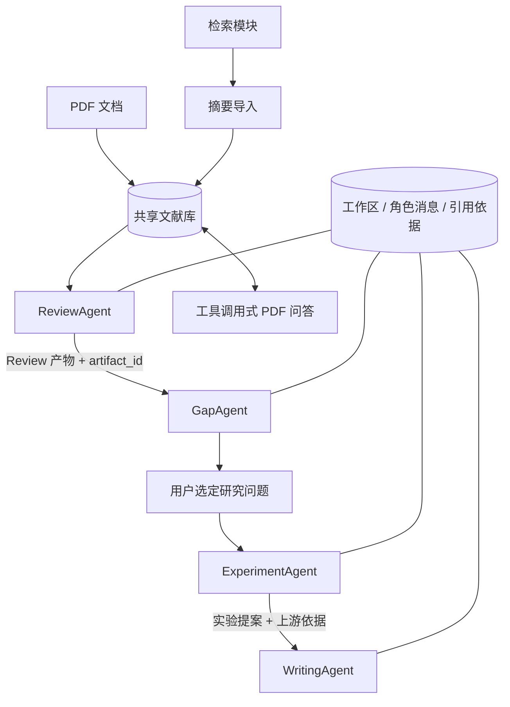

# 五个功能如何联动

## 用户路径

1. 在「研究工作台」建立主题，取得工作区 ID 和共享文献库 ID。
2. 在「跨库检索」获取论文；在「PDF 文献问答」把摘要或带文本层 PDF 导入同一库。
3. 回到工作台运行综述，接着运行空白分析。
4. 选定一个候选研究问题，交给实验设计。
5. 基于实验方案生成**研究提案**，不虚构已开展实验或 Results。
6. 随时在 PDF 问答页对同一文献库追问，检查引文与页码。

## 真实通信是什么

角色运行在同一 Python 服务内，通过 SQLite 持久工作区与结构化产物传递上下文。

`Coordinator` 发送 `task_assigned` 事件，包含上游产物 ID、证据 ID 和已选问题；角色交付后记录 `artifact_ready`，接收方是下游角色。消息不是装饰性聊天：下游实际收到上游结构化内容和引用对应的原文。模型不知道数据库路径、没有任意文件访问工具。

## 数据契约

| 角色 | 交付字段 |
| --- | --- |
| ReviewAgent | synthesis、evidence |
| GapAgent | candidates：question / rationale / uncertainty；evidence |
| ExperimentAgent | hypothesis、steps、controls、metrics、risks、evidence |
| WritingAgent | background、proposed_methods、outline、evidence |

Pydantic 拒绝缺字段、未知字段、过大内容；引用需指向共享资料内本轮提供的片段，并匹配原文。结构或引用不合格时允许一次更正，仍失败则不保存新产物。`evidence` 中逐条事实声明有引文检查；综合段落、空白推断和实验提案仍需人工审阅，不能说成所有文字都已获得语义证明。

## 状态与失效

- 共享库文档集合的哈希改变 → 清空当前分析与问题选择，保留交接事件。
- 重跑综述 → 后续空白、方案、写作失效。
- 重跑空白或更换问题 → 方案与写作失效。
- 不允许把离线示例产物交给真实模型作为已完成研究。
- 保存时比较版本和原状态，避免另一个请求覆盖已经更新的工作区。
- 旧产物正文未做全版本归档；消息里只保留失效产物 ID。如需旧正文，请提前导出。

## 面试时怎样称呼

这是**中心协调器编排的多角色研究流水线**，角色间有类型化通信与共享证据。研究阶段顺序由程序指定；不是让五个模型自由群聊，也不是多进程分布式 Agent 系统。PDF 问答内部是另一层有界、模型自主选择工具的循环。

原有独立分析页面保留，兼容历史操作；统一交接、依赖与门禁在「研究工作台」执行。不要把旧页面每一个按钮都说成已采用新协议。
